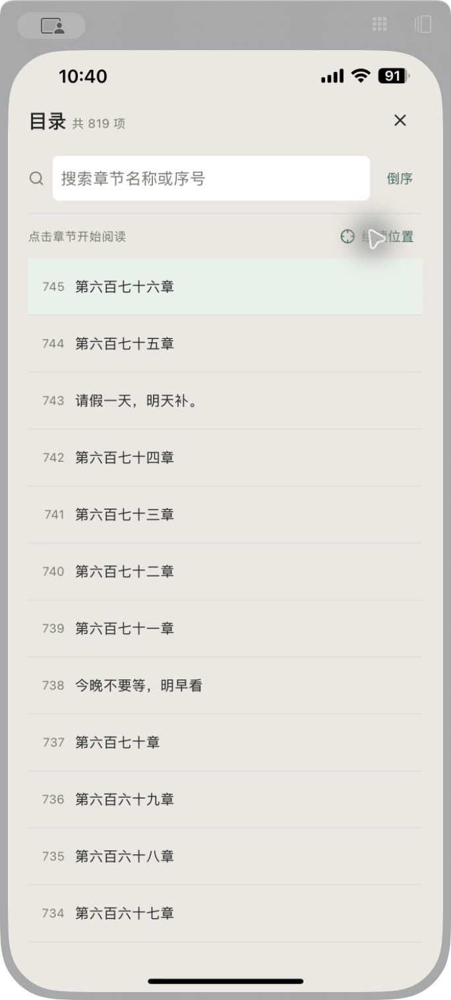

# 书籍详情页后续走查

2026-10-11。延续详情页排版与吸顶优化，使用 Swell5 手机镜像重新取证，沿用现有主题和控件。

## 本轮范围

1. 详情页首屏：有阅读进度的《捞尸人》可正确显示 90%、追更中、缓存数量和继续阅读章节，现有卡片层次与固定操作栏保留。
2. 目录浏览：旧目录固定 56pt 高度、标题限制一行，长标题仍会省略；四位目录序号使用原 24pt 宽度也可能折行。改为按完整标题自然增高，序号列根据总项数留足宽度。
3. 搜索与续读定位：旧目录没有清空和定位入口，搜索会沿用匹配到的当前阅读位置，可能越过更早的结果。新增匹配数量、清空搜索和“续读位置”，搜索从首个结果开始；显式定位清空筛选并保留排序，不进入阅读或改变进度。
4. 键盘与可变高度：iOS 键盘压缩目录滚动区，提交搜索与定位时可收起；可变行高定位先靠近目标，完成测量后重试，搜索切换或关闭弹层取消旧定位任务。

## 调整前真机取证

“标题单行省略”和“四位序号宽度”来自当前代码检查；本轮这张《捞尸人》截图只有三位序号，没有将该截图当成四位数字折行的复现证据。

## 调整后真机复核

新版覆盖安装后，《捞尸人》仍显示 90% 阅读进度和第六百七十六章的续读按钮。打开可变行高目录，正确停在目录第 745 项；切换倒序会从末尾浏览，点“续读位置”又准确回到第 745 项并保留倒序。两次定位都未进入阅读器。

按序号搜索 `7` 时展示 1 / 819 个匹配项，清空按钮和续读定位入口保持可见。
点击清空后恢复完整目录，并再次显示倒序下第 745 项的续读高亮；关闭弹层后继续阅读按钮仍是第六百七十六章。

## 验证结果

- 新增目录回归覆盖完整标题、1200 项目录中的四位序号、原始章节索引、搜索起点、匹配数量、清空、倒序定位、未测量行高重试、旧任务取消、空目录及键盘提交。
- 详情页与目录相关 14 项测试通过；TypeScript、相关文件 ESLint 通过。
- 首次全量回归在原生编译并行时有一项旧广告净化 JSDOM 长目录用例超时；原生编译结束后重新执行 `npm run check` 成功，78 套件、566 项测试全部通过，未扩大测试超时时间。
- TypeScript 通过，ESLint 0 errors / 191 warnings；Web production 构建通过，仍有 2 条包体积警告。`git diff --check` 通过。
- Swell5 Release 构建、覆盖安装、自动启动成功。最终源码修改时间 10:37:20，包内 main.jsbundle 生成时间 10:39:21，调整后截图来自该版本。

本轮不改网站解析、阅读进度、缓存或更新业务流程。没有宣称全部字体倍率、VoiceOver、横屏或完整无障碍合规已验收；镜像使用硬件键盘，软键盘高度需单独验证。长标题不再限行、四位序号宽度由自动化用例验证；本轮真机已有目录样本未找到超过一行的标题，因此没有把普通标题截图当成长标题换行的视觉验收。

改动尚未提交。
